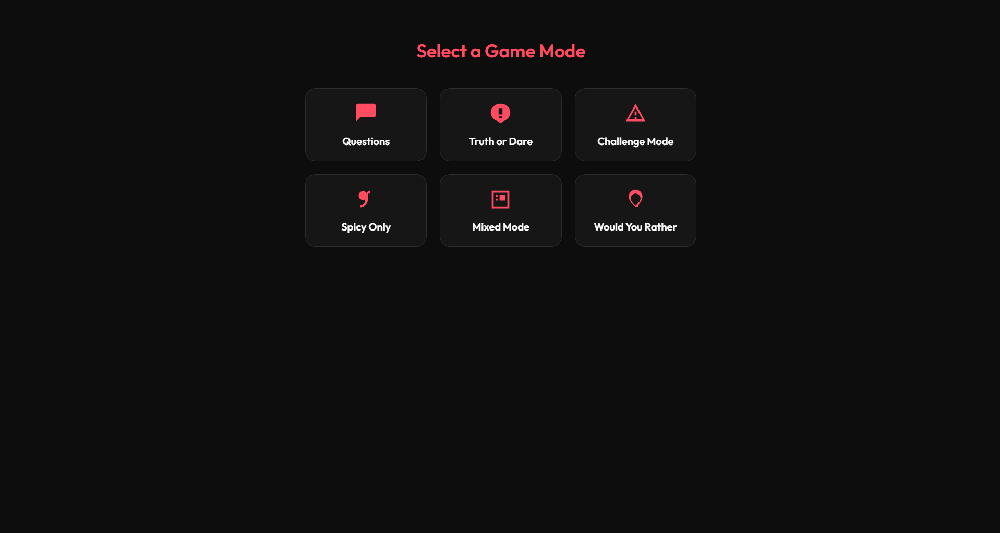

# Me & You


## Project Overview

Me & You is a playful, mobile-friendly web application built with Django for two people to share a private, interactive game experience. Players can create a session with a secret word, choose from several themed game modes, and explore a rotating set of questions, challenges, and prompts.

The app is designed to feel like a lightweight social game that can be played casually at home, during dates, or in any private setting. It also includes support for custom questions so each couple can personalize the experience.

visit https://me-nd-you.onrender.com

## Key Features

- Private game sessions using a shared secret word
- Multiple game modes including Questions, Truth or Dare, Challenges, Spicy Only, Mixed Mode, and Would You Rather
- Randomized prompt delivery with a flip-card style experience
- Custom question creation for each couple
- Mobile-friendly and PWA-ready interface
- Session persistence for a smoother user experience
- REST API support for questions and session management
- Real-time communication support via WebSockets

## Screenshots

> Placeholder screenshots for future documentation.





## Tech Stack

- Python
- Django
- Django REST Framework
- Django Channels
- SQLite (default development database)
- HTML, CSS, and JavaScript
- Progressive Web App (PWA) support

## Installation and Local Setup

### Prerequisites

- Python 3.10 or higher
- pip
- Virtual environment tool (optional but recommended)

### Setup Instructions

1. Clone the repository:
   ```bash
   git clone https://github.com/Eniola-as/me_nd_you.git
   cd me_nd_you
   ```

2. Create and activate a virtual environment:
   ```bash
   python -m venv .venv
   .\.venv\Scripts\activate
   ```

3. Install dependencies:
   ```bash
   pip install -r requirements.txt
   ```

4. Apply database migrations:
   ```bash
   python manage.py migrate
   ```

5. Start the development server:
   ```bash
   python manage.py runserver
   ```

## Running the Development Server

After setup, open your browser and visit:

```text
http://127.0.0.1:8000/
```

You can then create a session, choose a game mode, and start playing.

## Project Structure

```text
me_nd_you/
├── game/
│   ├── templates/
│   │   └── game/
│   ├── migrations/
│   ├── models.py
│   ├── views.py
│   ├── serializers.py
│   ├── consumers.py
│   └── urls.py
├── me_nd_you/
│   ├── settings.py
│   ├── urls.py
│   └── asgi.py
├── static/
│   ├── icons/
│   ├── js/
│   └── service-worker.js
├── manage.py
├── requirements.txt
└── questions.json
```

## How the Game Works

1. The user enters two names and a secret word to create or join a private session.
2. The app stores the session and associates it with the couple.
3. The player selects a game mode from the available list.
4. A shuffled set of questions is loaded from the backend.
5. The frontend displays each prompt in a card-based interface.
6. Players can flip the card, move to the next prompt, and add their own custom questions.

## Future Improvements

- Improve multiplayer syncing for more reliable real-time play
- Add user authentication and account profiles
- Add admin tools for managing prompts and categories
- Improve the UI with richer animations and accessibility enhancements
- Add more moderation controls for custom questions
- Support deployment improvements for a more stable live experience

## Known Limitations

> ## Live Demo Notice

The live version of this application is hosted on **Render's free hosting tier**. Because of the limitations of the free plan, some features that depend on persistent connections or online session sharing (such as multiplayer gameplay) may not function as intended in the deployed version.

The application has been fully developed and tested locally, where all gameplay and real-time features work as expected. These limitations are caused by the hosting environment rather than the application's implementation.

For the best experience, clone the repository and run the project locally using the setup instructions below.


## Contributing

Contributions are welcome. If you would like to improve this project, please follow these steps:

1. Fork the repository
2. Create a feature branch
3. Make your changes
4. Commit your work
5. Open a pull request

## License

This project is licensed under the MIT License. See the [LICENSE](LICENSE) file for details.

## Author

- GitHub: [Eniola-as](https://github.com/eniola-as)

