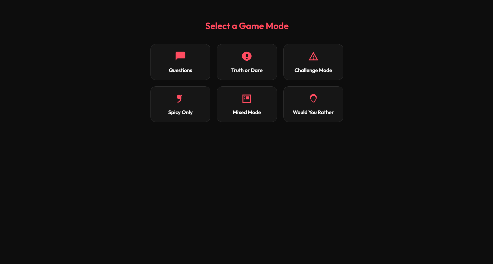
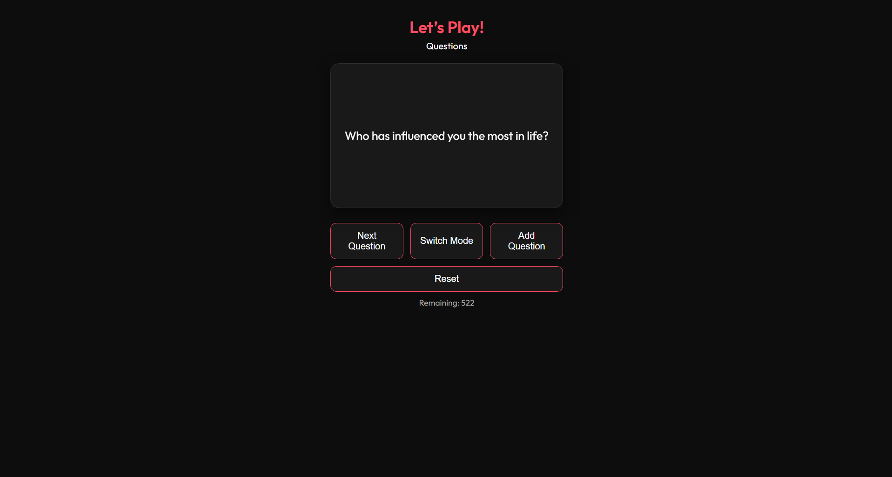

# Me & You


## Project Overview

Me & You is a playful, mobile-friendly web application built with Django for two people to share a private, interactive game experience. Each person has an account; partners share a private couple space, choose from several themed game modes, and play through the same shuffled deck of questions, challenges, and prompts together.

The app is designed to feel like a lightweight social game that can be played casually at home, during dates, or in any private setting. It also includes support for custom questions so each couple can personalize the experience.

visit https://me-nd-you.onrender.com

## Key Features

- Email accounts with display names; partners never see each other's email
- Email verification (a reminder, never a requirement) and password reset by email
- Private couple spaces, joined with a single-use invitation link
- Multiple game modes including Questions, Truth or Dare, Challenges, Spicy Only, Mixed Mode, and Would You Rather
- A server-held game: both partners always see the same card, in real time over WebSockets
- Questions mode: each partner can answer privately, and both answers are revealed together once you've both answered (answering is optional)
- Flip-card prompts, and custom questions that join the shared deck straight away
- Leaving a couple closes it for both partners; an admin can restore it
- Private couple chat from a floating icon on the play page, space page and mode menu: unread badge, partner presence ("Playing Truth or Dare", "Last seen 5 min ago"), typing indicator, and deleting your own messages
- Emoji reactions on chat messages and revealed answers, with a quick row and "+" for any emoji
- Chat messages encrypted at rest (not end-to-end; see Known Limitations)
- Mobile-friendly, installable PWA

## Screenshots

> Placeholder screenshots for future documentation.






## Tech Stack

- Python
- Django
- Django REST Framework
- Django Channels
- SQLite (default development database)
- HTML, CSS, and JavaScript
- Progressive Web App (PWA) support

## Installation and Local Setup

### Prerequisites

- Python 3.10 or higher
- pip
- Virtual environment tool (optional but recommended)

### Setup Instructions

1. Clone the repository:
   ```bash
   git clone https://github.com/Eniola-as/me_nd_you.git
   cd me_nd_you
   ```

2. Create and activate a virtual environment:
   ```powershell
   # PowerShell (Windows)
   python -m venv .venv
   .\.venv\Scripts\Activate.ps1
   ```
   ```bash
   # Bash (macOS/Linux; in Git Bash on Windows, use .venv/Scripts/activate)
   python -m venv .venv
   source .venv/bin/activate
   ```

3. Install dependencies:
   ```bash
   pip install -r requirements.txt
   ```

4. Create your local settings file from the template. The app will not start
   without it, because `SECRET_KEY` has no default:
   ```powershell
   Copy-Item .env.example .env   # PowerShell
   ```
   ```bash
   cp .env.example .env          # Bash
   ```
   Then replace `SECRET_KEY` in `.env` with a long random string, and set
   `CHAT_ENCRYPTION_KEYS` to a key of your own so chat works locally
   (`.env.example` shows the one-line command that makes one). Never reuse
   the production key locally.

5. Apply database migrations (this also loads the question bank):
   ```bash
   python manage.py migrate
   ```
   Run this again after pulling new code. If `runserver` says "You have
   unapplied migrations", the app's pages will fail until you do.

6. Start the development server (Daphne's ASGI server, so WebSockets work
   locally too):
   ```bash
   python manage.py runserver
   ```

Deployment to Render is described in [docs/DEPLOYMENT.md](docs/DEPLOYMENT.md).

## Running the Tests

```bash
python manage.py test accounts couples game play chat
node --test "tests/js/*.test.js"
```

The JavaScript tests need Node.js 20 or newer and have no dependencies to install.

## Running the Development Server

After setup, open your browser and visit:

```text
http://127.0.0.1:8000/
```

Create an account, start a couple space, send your partner the invitation link, then choose a game mode and play.

## Project Structure

```text
me_nd_you/
├── accounts/        # Email accounts, sign-in, display names
├── couples/         # Couple spaces, invitations, leaving and admin recovery
├── game/            # Question bank, landing/modes/play pages, custom questions
│   ├── fixtures/
│   │   └── questions.json
│   ├── templates/
│   │   └── game/
│   ├── migrations/
│   ├── tests/
│   ├── models.py
│   ├── views.py
│   └── urls.py
├── play/            # Server-authoritative game engine: rooms, actions, WebSockets
├── chat/            # Couple chat: encrypted messages, reactions, presence, WebSocket
├── me_nd_you/
│   ├── settings.py
│   ├── urls.py
│   └── asgi.py
├── static/
│   ├── icons/
│   ├── js/
│   └── service-worker.js
├── tests/
│   └── js/
├── manage.py
├── requirements.txt
└── .env.example
```

## How the Game Works

1. Each partner creates an account; one starts a couple space and sends the other a single-use invitation link.
2. Either partner picks a game mode.
3. The server shuffles that mode's questions (plus the couple's own) into one deck for the couple.
4. Next and Reset are requests to the server, which applies each one once, in order, and sends both partners the same card.
5. Players flip the card, move on, and add their own questions, which join the deck for both.

## Pre-launch Checklist

Approved and in progress before the first public launch:

- An 18+ age confirmation at sign-up
- A privacy policy and terms page, with explicit, separate consents at sign-up (terms and privacy; intimate content; data stored outside Nigeria)
- Self-hosted fonts, so no third party sees visitors
- "Download my data" from the profile page
- Account deletion by users, with a 7-day undo
- Closed couple spaces permanently deleted 30 days after closing
- The admin pages never show custom-question text
- A short data-breach response plan: affected users told at once for high-risk breaches, and the Nigeria Data Protection Commission (NDPC) notified within 72 hours

## Roadmap

In this order, each with its own plan and approval first:

1. Comfort setting (Sweet / Spicy), chosen by each partner, the couple playing at the lower of the two, enforced on the server in every mode
2. Would You Rather with private picks, revealed together (reusing the answer-reveal engine)
3. Saved answer history for Questions mode, encrypted at rest like chat, and included in data export and account deletion
4. PWA offline loading and install
5. Deploy to Render
6. Then the Product Expansion Master Plan ([docs/EXPANSION_PLAN.md](docs/EXPANSION_PLAN.md)): new games, Couples and Friends spaces, personalisation

## Future Improvements

- End-to-end encryption for chat
- An app lock (PIN)
- Disappearing messages
- Improve multiplayer syncing for more reliable real-time play
- Add admin tools for managing prompts and categories
- Improve the UI with richer animations and accessibility enhancements
- Add more moderation controls for custom questions
- Support deployment improvements for a more stable live experience

## Known Limitations

> ## Live Demo Notice

The live version of this application is hosted on **Render's free hosting tier**. Because of the limitations of the free plan, some features that depend on persistent connections or online session sharing (such as multiplayer gameplay) may not function as intended in the deployed version.

Live updates between partners use Channels' in-memory layer, which works within one server process. Running several processes would need a shared layer such as Redis.

Changing an account's email address isn't possible yet.

Signing up with an email that already has an account shows a generic message and emails that account's owner (at most once a day). Because sign-up signs new users in straight away, the page still differs from a successful sign-up, so checking whether an email is registered is slowed (5 attempts per minute per client) and reported to the owner, not prevented.

Verification and password-reset emails are sent from a background thread. If the server restarts mid-send, that email is lost; requesting another one works. Like the rate limits, the one-verification-email-per-2-minutes limit is counted per server process.

Locally, emails are printed in the terminal running the server (no provider needed); copy the link from there.

Chat messages are encrypted at rest with the key in `CHAT_ENCRYPTION_KEYS`. This is **not end-to-end encryption**: the server decrypts messages to deliver them, so anyone with both the server's configuration and the database could read them. **Losing every key in `CHAT_ENCRYPTION_KEYS` permanently loses every chat message**; there is no recovery (see docs/DEPLOYMENT.md).

Chat presence ("online", "Playing …") is tracked in the server's memory, in the one Daphne process, like the channel layer. If a phone loses its connection without closing it (for example out of signal), the partner may keep seeing "online" until the server notices the connection has dropped. Closing or leaving the page updates it at once. "Last seen" is stored.

On phones, pages with the chat icon scroll inside the area above the icon, so the browser's address bar may not hide while you scroll.

The app installs as a PWA, but pages don't load offline yet: the service worker is registered with the scope `/static/`, so it doesn't control any app page. Fixing this is a small future task (serve the worker from `/` and cache the pages it should open offline).

## Contributing

Contributions are welcome. If you would like to improve this project, please follow these steps:

1. Fork the repository
2. Create a feature branch
3. Make your changes
4. Commit your work
5. Open a pull request

## License

This project is licensed under the MIT License. See the [LICENSE](LICENSE) file for details.

## Author

- GitHub: [Eniola-as](https://github.com/eniola-as)

